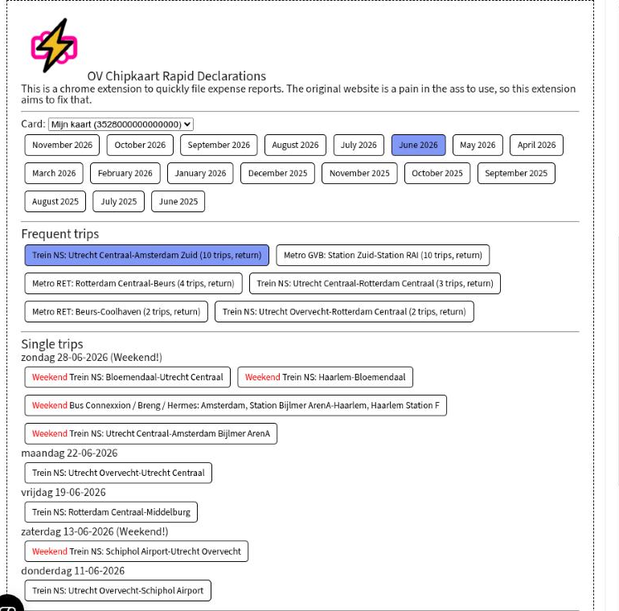
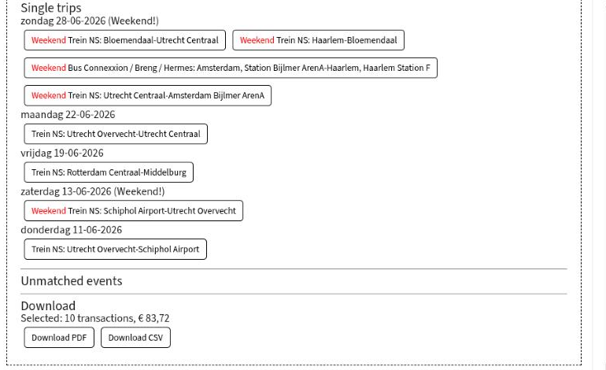

# OV Chipkaart Rapid Declarations

Declare your OV-chipkaart trips in seconds, not 10 minutes.

A Chrome extension for [ov-chipkaart.nl](https://www.ov-chipkaart.nl/mijn-ov-chip/mijn-ov-reishistorie) that adds a panel to the *Mijn OV-reishistorie* page. Pick a card and a month, click the trips you want to declare, and download the declaration overview as PDF or CSV.

## Features

- **One click per month**: buttons for the last 18 months, no fiddling with date pickers.
- **Frequent trips grouped**: recurring trips (and their return trips) are bundled, so selecting your commute for a whole month is a single click.
- **Weekends flagged**: weekend trips are marked in red, so you don't accidentally declare your day at the beach. Saturday-night trips before 07:00 count as Friday.
- **Unmatched events**: check-ins without a check-out (and vice versa) are listed separately.
- **Running total**: see how many transactions you've selected and what they add up to.
- **Sensible file names**: downloads are named like `ov-chipkaart-nl-Mijn-kaart-June-2026.pdf`.

## How it works

The extension doesn't scrape the travel history table. It talks to the same backend the site itself uses (`/backend/moc/...`), with your existing login session:

- `cards/retrieve` and `cards/retrievedetails` for your cards,
- `cardtravelhistory/cardtransactions` for the trips in a month,
- `cardtravelhistory/generatedocument` to have ov-chipkaart.nl generate the official PDF/CSV for the selected trips.

Nothing leaves your browser except requests to ov-chipkaart.nl itself.

## Installation

Not in the Chrome Web Store (yet). To install it manually:

1. Clone this repository.
2. Open `chrome://extensions` and enable **Developer mode**.
3. Click **Load unpacked** and select the `chrome-extension` folder.
4. Log in at ov-chipkaart.nl and open *Mijn OV-reishistorie*.

## History

I first built something like this in 2012, when I had to submit my travel expenses every month. Then I got a company card and stopped needing it. In 2024 I went freelance and rebuilt it. In 2026 I added some finishing touches with Claude: the extension now uses the site's API instead of scraping it.

And after all these years, the site still sucks!

*Not affiliated with Translink or OV-chipkaart.*
